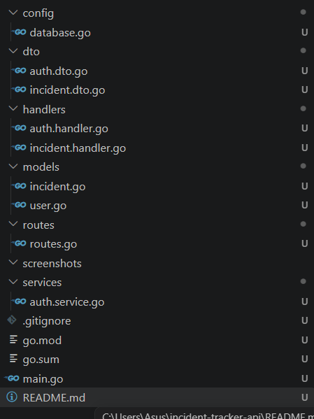
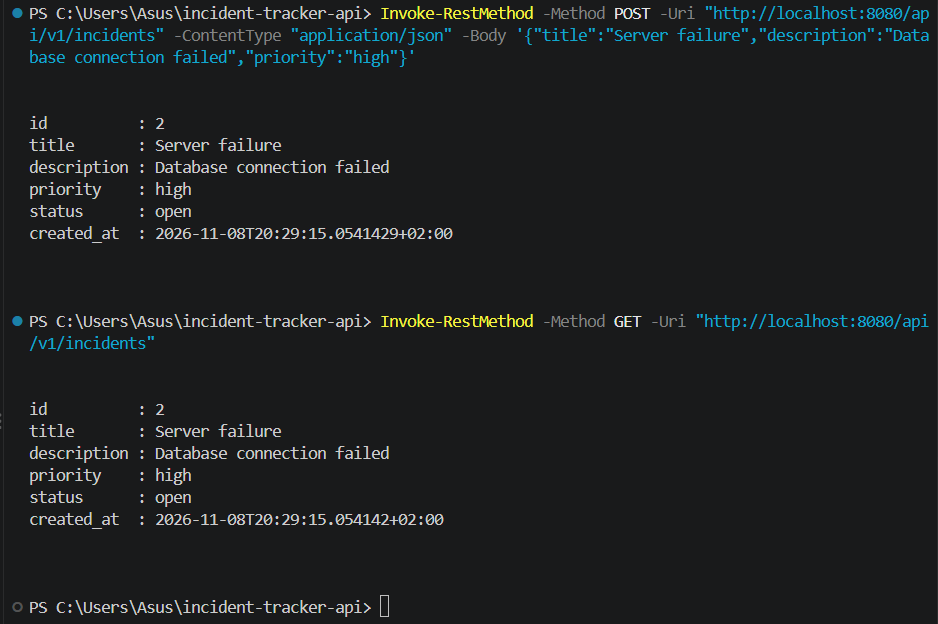
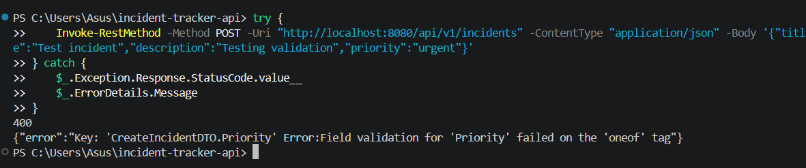
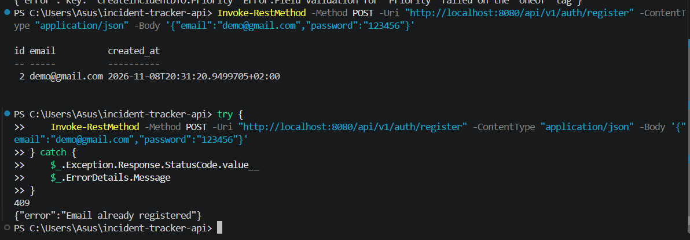
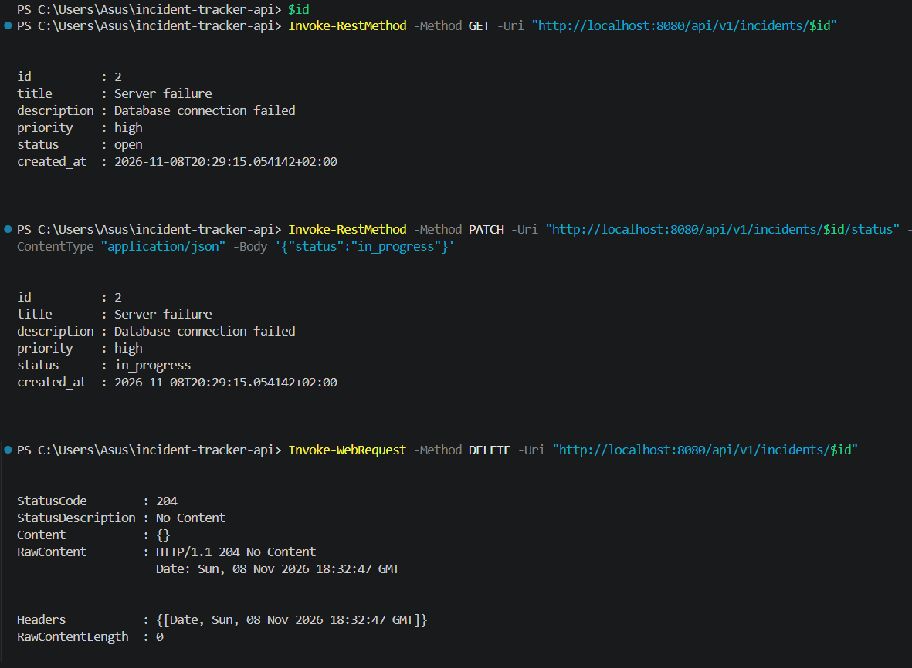

# Практична робота: Розробка REST-сервісу на базі Gin та PostgreSQL

## Мета роботи

Розробити REST API для системи відстеження інцидентів із використанням мови Go, фреймворку Gin та бази даних PostgreSQL.

## Використані технології

- Go
- Gin
- GORM
- PostgreSQL
- Docker
- JWT
- bcrypt

## Виконання роботи

### 1. Структура проєкту

Проєкт організовано за допомогою окремих пакетів для конфігурації бази даних, моделей, DTO, обробників запитів, маршрутів та сервісів.

### 2. Робота з інцидентами

Реалізовано створення інцидентів за допомогою POST-запиту та отримання списку інцидентів за допомогою GET-запиту. Дані зберігаються у PostgreSQL.

### 3. Валідація даних

Реалізовано перевірку вхідних даних. Перевірено обробку неправильного значення пріоритету. Сервер повертає помилку HTTP 400.

### 4. Реєстрація та авторизація

Реалізовано реєстрацію користувачів із хешуванням паролів за допомогою bcrypt та авторизацію з використанням JWT. Повторна реєстрація з однаковою електронною адресою повертає HTTP 409.

### 5. Керування інцидентами

Реалізовано отримання інциденту за ідентифікатором, зміну його статусу та видалення. Перевірено успішне виконання відповідних HTTP-запитів.

## Реалізовані API-ендпоїнти

| Метод | Маршрут | Призначення |
|---|---|---|
| POST | `/api/v1/incidents` | Створення інциденту |
| GET | `/api/v1/incidents` | Отримання списку інцидентів |
| GET | `/api/v1/incidents/:id` | Отримання інциденту за ID |
| PATCH | `/api/v1/incidents/:id/status` | Зміна статусу |
| DELETE | `/api/v1/incidents/:id` | Видалення інциденту |
| POST | `/api/v1/auth/register` | Реєстрація користувача |
| POST | `/api/v1/auth/login` | Авторизація користувача |

## Висновок

Під час виконання практичної роботи було розроблено REST API на базі Go та Gin із підключенням PostgreSQL через GORM. Реалізовано CRUD-операції для інцидентів, валідацію даних, реєстрацію та авторизацію користувачів із використанням bcrypt і JWT. Основні функції сервісу були перевірені за допомогою HTTP-запитів.